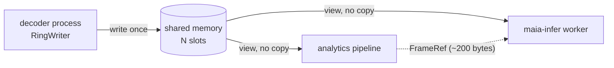

# maia-ring

**Pass video frames between processes without copying them.**

A frame ring in shared memory: one process decodes video and writes frames, any number of
processes on the same machine read them. Readers can take a copy, or read the frame in place
as a numpy array with no copy at all. No locks are shared between processes, so a slow or
crashed reader can never stall the writer.

It is the frame bus under [maia-gateway](https://github.com/jemaia-elwrose/maia-gateway) and
lets [maia-infer](https://github.com/jemaia-elwrose/maia-infer) workers read frames by reference
instead of receiving pixels. Pure Python plus numpy; Linux and macOS.



## Quick start

```python
from maia_ring import RingWriter, RingReader

# writer (e.g. the gateway's ingest process)
w = RingWriter("cam-gate-1", slots=16, width=1280, height=720)
ref = w.write(frame)  # one memcpy; returns a FrameRef

# reader, in any other process
r = RingReader("cam-gate-1")
f = r.latest()  # newest frame, copied out: safe to keep
f = r.latest(copy=False)  # newest frame as a view into shared memory
result = model(f.array)
if not f.still_valid():  # overwritten while we used it: discard result
    ...
```

Write in place, for example straight from a decoder's buffer:

```python
view = w.begin()  # writable view of the next slot
decoder.fill(view)
del view
ref = w.commit(pts_ns=pts, flags=IFRAME)
```

Send a frame to another process by reference:

```python
msg = ref.to_dict()  # ~200 bytes of JSON instead of 2.7 MB of pixels
# ... in the receiving process
pool = RingPool()  # caches one reader per ring, reattaches on restarts
frame = pool.get(msg)  # a view; raises StaleFrame if it was overwritten
```

## How it stays correct

Each slot has a sequence number (a seqlock). The writer makes it odd, writes, and makes it
even; a reader notes it, reads, and checks it again. If it changed, the frame was overwritten
mid-read and the read is retried (newest frame) or reported as `StaleFrame` (a specific
frame). Views follow the same rule: use the data, then call `still_valid()`.

The test suite proves it: a writer in one process laps two readers in others through a
3-slot ring at 70,000 to 190,000 frames a second (x86 VM and Apple Silicon). Every frame a reader accepts is checked
pixel by pixel; none is torn. With the seqlock disabled the same test catches hundreds of
torn frames, so it is a real check, not a lucky one.

Details that are easy to get wrong, handled here:

- **Memory ordering.** On x86 the CPU keeps stores in order, so the seqlock is exact. ARM
  (Apple Silicon, Graviton) may reorder them, and Python has no memory-barrier instruction;
  maia-ring uses a mutex lock and unlock as one. That works in practice and CI runs the
  torn-frame test on ARM macOS, but it is not a formal guarantee. A small optional C
  extension with real atomic fences is planned for 0.2.
- **Python's resource tracker** (before 3.13) deletes shared memory that a process merely
  attached to when that process exits. Readers detach from it, so a reader quitting never
  deletes the writer's ring.
- **Writer restarts.** A new writer recreates the ring with a new instance id; readers and
  `RingPool` notice and reattach instead of reading a dead segment forever.
- **Page-aligned slots**, so a slot can be registered with Triton's system shared memory.

## Cost per frame

`maia-ring bench` on the machine you run it on, BGR uint8:

| Machine | Size | Write | Read, copy | Read, view | Plain memcpy |
|---|---|---|---|---|---|
| MacBook Air, Apple Silicon | 720p (2.8 MB) | 49 µs | 41 µs | 2.4 µs | 38 µs |
| | 1080p (6.2 MB) | 109 µs | 89 µs | 2.3 µs | 87 µs |
| | 4K (24.9 MB) | 582 µs | 496 µs | 2.4 µs | 474 µs |
| 2-core x86 cloud VM | 720p | 340 µs | 246 µs | 2.6 µs | 225 µs |
| | 1080p | 744 µs | 589 µs | 4.9 µs | 502 µs |
| | 4K | 3.0 ms | 2.0 ms | 4.1 µs | 2.2 ms |

A copy costs what a memcpy costs; a view costs the same at any size, because nothing moves.

```bash
maia-ring bench --sizes 720p 1080p 4k
maia-ring info cam-gate-1        # a live ring: geometry, frames written, newest frame's age
```

## Format

The byte layout is specified in [docs/ring-format.md](docs/ring-format.md), so a reader or
writer in C, C++ or Rust can share rings with Python ones.

## Development

```bash
pip install -e ".[dev]"
pytest -q -s       # 18 tests, ~7 s; -s prints the torn-frame test's counts
ruff check . && ruff format --check .
```

## License

MIT
